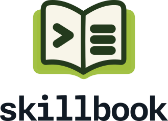

<p align="center">
  <picture>
    <source media="(prefers-color-scheme: dark)" srcset="assets/skillbook-logo-light.svg">
    
  </picture>
</p>
<p align="center"><a href="https://github.com/remziduzagac/skillbook/actions/workflows/ci.yml"></a></p>

skillbook is a book of skills for AI agents such as Claude Code and Codex: instructions an agent loads to understand what you want, do the work with care and tell you plainly what it did. The skills come in sets you install separately: essentials, for how any work is done, and sets for keeping a project's design record, engineering software, writing for people, keeping the rhythm of your working days and keeping what you learn. Other agents that read skills can use them too.

<p align="center">
  
</p>

**Status:** essentials is released, at an early 0.x version, for use and feedback; the other sets are still being designed.

## The plan

| Sets | What they cover |
| --- | --- |
| [essentials][es-docs] | how the agent behaves, understands, arranges, coordinates, designs and plans, with care |
| [blueprint][bp-idea] | the spec-to-dev flow: a project's design record, decisions and tasks, kept in step |
| [softeng][se-idea] | how good software is designed, built, tested, reviewed, shipped and maintained |
| [authoring][au-idea] | writing for people: user docs, business documents, articles, issues; editing |
| [cadence][ca-idea] | the rhythm of your working days: meetings, tasks, reviews and wrapping up work |
| [compendium][co-idea] | what you learn: capturing notes and sources, distilling them, and finding them again |

[es-docs]: docs/essentials/README.md
[bp-idea]: docs/blueprint/idea.md
[se-idea]: docs/softeng/idea.md
[au-idea]: docs/authoring/idea.md
[ca-idea]: docs/cadence/idea.md
[co-idea]: docs/compendium/idea.md

Each set is installed as one skill in the agent’s skill list. Its files under `references/` are guides. Essentials reads five guides on every request, reads its other main guides when their stage has work, and uses a guide map to choose any further guides the work needs. Its guides shape how the agent works; other available skills and tools do the work itself. Essentials works on its own and names no other set.

## Installing

Each set installs on its own, with one line, on Linux and macOS; on Windows, use WSL. For essentials:

```sh
curl -fsSL https://remziduzagac.github.io/skillbook/install-essentials.sh | sh                   # the latest release
curl -fsSL https://remziduzagac.github.io/skillbook/install-essentials.sh | sh -s -- --preview   # the newest preview
```

Then ask your agent to **set up skillbook**: with your approval, it adds the line that tells the agent to load essentials before any work, and what your agent needs to read the installed files. Run the same line again to update. A preview is what the next release will hold, published to try it first. [Installing skillbook](docs/install.md) covers the options, checking the files, previews and removing.

## Documentation

- [Documentation](https://remziduzagac.github.io/skillbook/docs/): installing, setting up your agent, versions and what each set does. The same pages are in [docs/](docs/README.md).
- [CHANGELOG.md](CHANGELOG.md): what each release changed.
- [CONTRIBUTING.md](CONTRIBUTING.md): reporting a problem, and working on skillbook, with the [code of conduct](CODE_OF_CONDUCT.md).
- [MAINTAINING.md](MAINTAINING.md): branches, versions, previews, releases, the docs site and the repository's settings.
- [blueprint/](blueprint/README.md): the design, with its decisions, research and roadmap.

## How it is organised

- `skills/<set>/`: one folder per set, once built; `skills/released` names the sets a release packs.
- [docs/](docs/README.md): the documentation, for people; [site/](site/) builds it into the documentation website.
- [docs/essentials/](docs/essentials/README.md): what essentials is for, how it works, and a line on each of its guides.
- [docs/blueprint/idea.md](docs/blueprint/idea.md): the first idea of the blueprint method, with [a worked example](docs/blueprint/idea.md#a-worked-example-worktree-groups).
- `docs/<set>/idea.md`: the first idea of each other set, such as [softeng](docs/softeng/idea.md).

## Use at your own risk

skillbook's skills guide an AI agent that reads files, runs commands and changes things on your machine. skillbook does not control what the agent does. You are responsible for everything the agent does with these skills, and for any result. So:

- review what the agent proposes and does before you accept it;
- keep backups, and keep your work under version control;
- use your agent's own permission settings.

skillbook is provided "as is", without warranty of any kind. Its authors and contributors are not liable for any damage or loss, as sections 7 and 8 of the [licence](LICENSE) say.

## Help and contributing

Report a skill that misbehaved in a real session as an issue; see [SCOPE.md](SCOPE.md) and [CONTRIBUTING.md](CONTRIBUTING.md). Security problems go through [SECURITY.md](SECURITY.md).

skillbook is maintained by Remzi Duzagac and licensed under the [Apache License 2.0](LICENSE).
